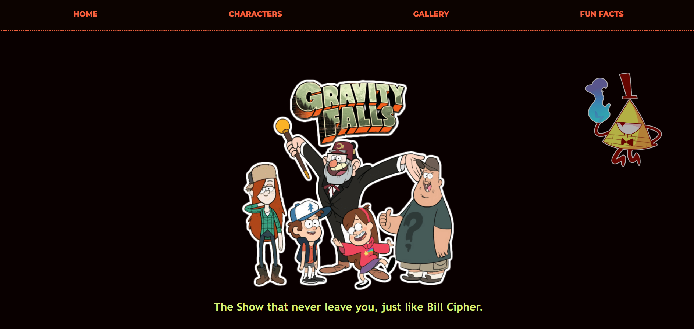

# Gravity Falls

- A fan website dedicated to the mysterious world of Gravity Falls. explore favourite characters, view memorable moments and discover funfacts.

# Demo

[View](https://udayprakash999.github.io/Gravity-Falls)

# Project 

# About 

- This website was created for fans of the animated series Gravity Falls. it has a simple and attractive design with dark theme.

# Features

- Gravity falls Dark theme design.
- Character section with character img and details.
- Gallery section.
- fun facts section with information.
- hover animations on cards and images.
- Responsive Design.
- Easy navigation between sections.
- Parllax Background

# Tech Stack

- HTML5
- CSS3
- CSS FLEXBOX
- CSS GRID
- CSS MEDIA QUERIES
- GOOGLE FONTS 
- GSAP Animation

# What I Learned 

- Creating website layout using html
- styling elements using css
- working with flexbox and css grid
- adding hover effects and animations.
- making website responsive using media queries.
- Parallax animation
- GSAP animations

# Author

**Uday Prakash Gupta**

- GitHub: [@udayprakash999](https://github.com/udayprakash999)